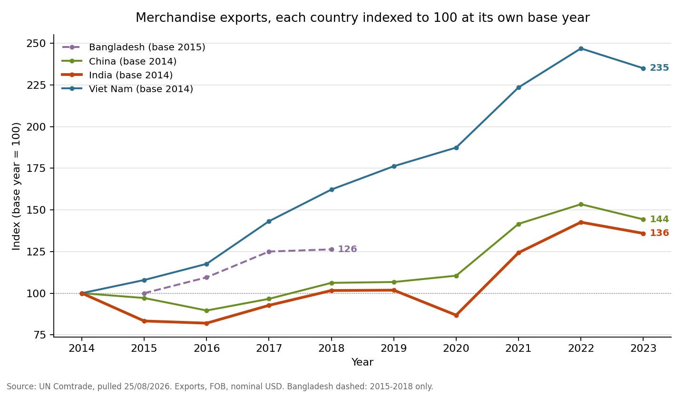
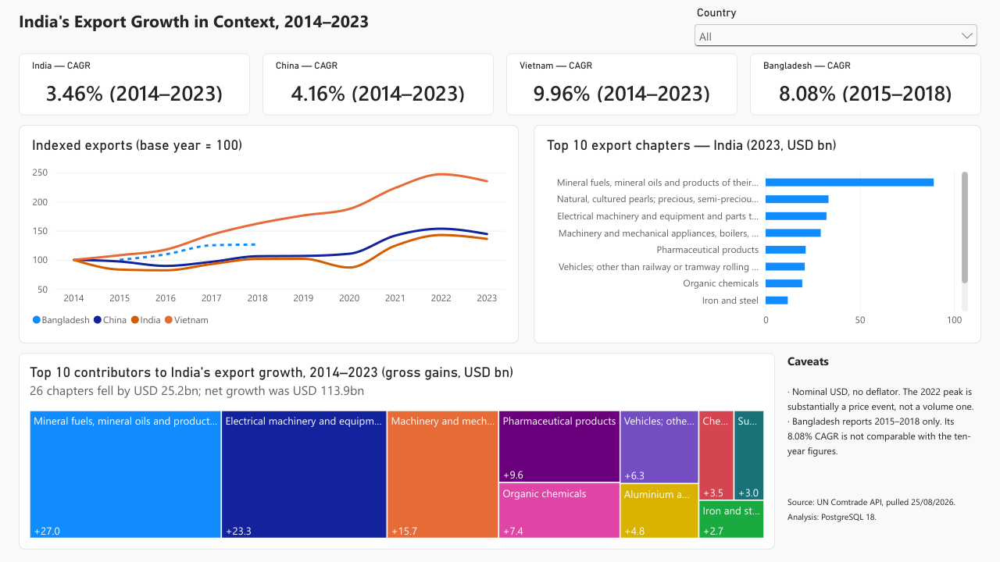
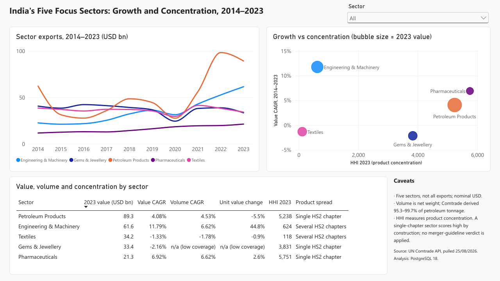
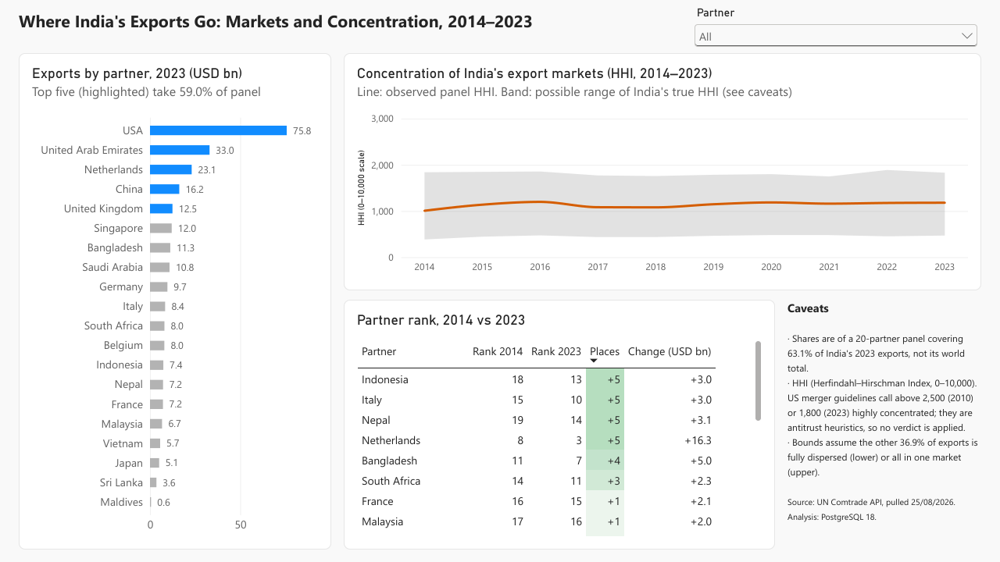
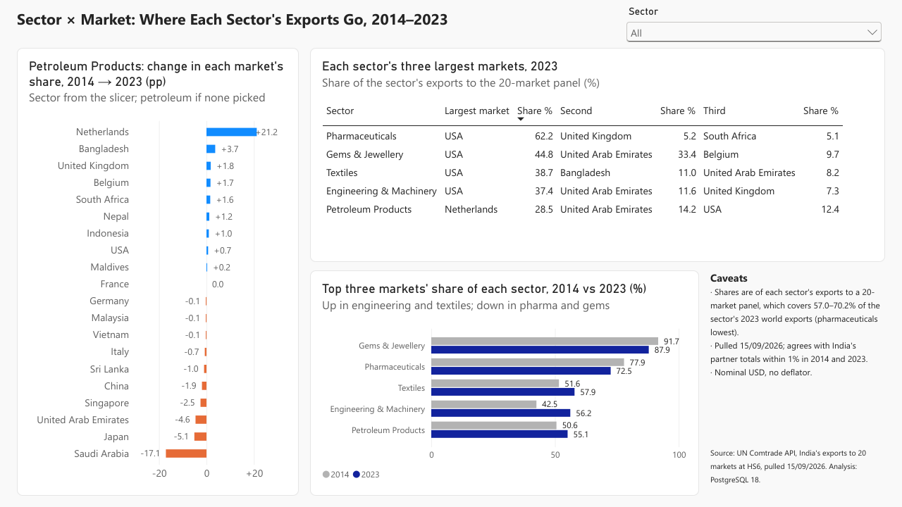
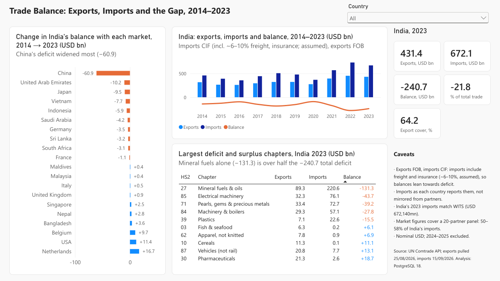

# International Trade Analytics: India's Export Profile (2014–2023)

A SQL-driven analysis of India's merchandise trade over the past decade — exports benchmarked against three comparator economies (China, Bangladesh, Vietnam), then where each sector's exports go, imports and trade balance, and volume against value — sourced directly from the UN Comtrade API. Built as a portfolio project in PostgreSQL, with Python for the charts and a Power BI dashboard.

> **Raw data not included.** The seven raw CSVs are not redistributed: at 284,752 records they exceed UN Comtrade's 100,000-record free limit. To get them, repeat the pull from [UN Comtrade](https://comtradeplus.un.org) with the parameters documented here. Everything else is here: the SQL, the 31 result tables in `data/processed/`, the findings, the charts and the Power BI dashboard, none of which need the raw files to read or open; re-running the SQL and its eighteen assertions does. The exact pull parameters are in [`data/raw/README.md`](data/raw/README.md).

**→ [Read the findings](insights/key_findings.md)** — twenty findings with the numbers, caveats attached.



> Over 2014–2023 India's exports compounded at **3.46% a year** to **USD 431.4bn**. Vietnam, a smaller exporter than India in 2014, compounded at **9.96%**. A fifth of India's basket is mineral fuels (20.7% of 2023 exports), which ties much of its value to world energy prices and makes its path the most volatile of the four; but its decade growth came more from machinery and electronics (34.3% of the USD 113.9bn added) than from petroleum (23.7%).

## Data source

**UN Comtrade API** (https://comtradeplus.un.org) — the UN Statistics Division's official repository of international merchandise trade statistics, built from member states' own customs declarations. Chosen over DGFT (India-only, narrower) and Kaggle mirrors (secondhand, unclear provenance) because it is primary international data, pulled programmatically, with documented reliability caveats rather than taken at face value.

The data came from two pulls — exports on 25/08/2026, imports and the partner × sector detail on 15/09/2026. Parameters, dates, SHA-256 checksums and a column-by-column data dictionary are in **[`data/raw/README.md`](data/raw/README.md)** and [`data/raw/pull_manifest.json`](data/raw/pull_manifest.json). The pull script is not published, and the raw CSVs it wrote are not included (see the note above); the exact parameters are documented so the pull can be repeated. Comtrade revises figures after publication, so a fresh pull may not match the analysed data byte for byte; the checksums in the manifest show whether it does.

### Scope

| Dimension | Decision |
|---|---|
| Reporters | India, with China, Bangladesh and Vietnam as comparators. **Bangladesh: 2015–2018 only** — most likely a gap in the source, since WITS shows nothing after 2015 either (`sql/02` assumption 2) |
| Years | 2014–2023. 2024–2025 excluded: recent Comtrade figures are frequently still being revised by reporters |
| Trade flow | Exports for all four reporters (Tracks A–D); imports for all four to World and for India by partner (Track E) |
| Valuation | Exports FOB, imports CIF, **nominal USD — no deflator**. Balances are FOB minus CIF, which overstates deficits by the freight margin (`sql/07` assumption 1) |
| Product detail | HS2, all ~97 chapters, for all four reporters. HS6 for India across five sectors — textiles, pharmaceuticals, gems & jewellery, petroleum products, engineering/machinery — to World (Track B) and by partner (Track D) |
| Partner markets | A **selected panel of 20 partners**, not a top-20 ranking, with no World row. Every partner share is a **share of the panel** (61.9%–64.4% of India's exports), not of India's global trade. Chosen for exports, it holds only a third of India's fuel imports (`sql/07` assumption 9) |
| Volume | Net weight on the HS6 tracks only — Comtrade holds no quantities at HS2 (`sql/03` assumption 7) |

**Known gaps, stated deliberately.** The comparators have HS2-to-World detail only, so the analysis can say Vietnam widened its surplus but not in what. Partner × sector is exports only. Tonnes are separated from price only for India's five sectors, and only as far as Comtrade's largely estimated tonnage allows. No HS edition concordance is applied, so product-level claims stay within one edition (`sql/02` assumption 7).

## Data reliability

- **Exporter/importer asymmetry.** Exports are valued FOB and imports CIF, so the two sides of a shipment rarely match. The IMF's CIF/FOB factor is 6% since 2017, 10% before (IMF Working Paper 18/16) — an assumed range, not measured here. Every export figure is the exporter's own report, never a partner's mirrored import.
- **No value in this pull is flagged as estimated — and this project got that wrong once.** `legacyEstimationFlag` marks estimated *quantity* and *net weight* only (FAO, UNSD and ITC, [*Trade data processing and validation methodology*](https://comtradeapi.un.org/files/v1/app/wiki/UNSD_Method_trade_data_processing_v6-17_Jun_2019.pdf) (2019), Part: UN Comtrade, "Documentation of estimated values"); the headline claim built on reading it as a value marker is withdrawn in [finding 12](insights/key_findings.md). What does bear on a 2014-vs-2023 comparison is each reporter's switch from filed to rolled-up chapter figures (`isReported` → `isAggregate`), reported in `sql/02` V1a/V1b.
- **Where estimation bites is weight.** 95–100% of the tonnage behind most sector volume series is Comtrade-estimated — by conversion factors, or from the value divided by a unit value (India's own where enough of the flow is reported, otherwise a standard one); [finding 17](insights/key_findings.md) carries this next to its conclusion.
- **Confidentiality suppression.** Some countries withhold commodity or partner detail; it still counts in totals but not in the breakdowns.
- **HS 99, "commodities not specified", is inside every total** — USD 212.4bn of China's decade exports (0.8%), 29.6bn of Vietnam's (1.2%) and 5.1bn of India's (0.15%) (`supporting_figures.csv`, 02 S3). It stays in because the published totals include it.

### Accuracy check against an external figure

Most validation here is self-consistency; one check is not. India's 2023 exports, summed from 97 HS2 chapters, come to **USD 431,411,977,211** against WITS's published **USD 431,411,977.21 thousand** — the same figure to WITS's published precision (USD 10), so no chapter is missing and nothing is double-counted. WITS draws on UN Comtrade, so this validates the arithmetic, not the underlying figure; India's own DGCI&S statistics are fiscal-year (April–March) and not directly comparable.
*Source: [WITS India country profile](https://wits.worldbank.org/CountryProfile/en/IND), accessed 08/09/2026.*

## Repository structure

```
trade-analytics/
├── dashboard/                  # Power BI project (PBIP) — all five pages
│   ├── trade_analytics.pbip            # Open this in Power BI Desktop
│   ├── screenshots/                    # One PNG per page, shown under Dashboard below
│   ├── trade_analytics.Report/         # Report (PBIR): one JSON file per page and visual
│   └── trade_analytics.SemanticModel/  # Data model (TMDL): tables, relationships, measures
├── data/
│   ├── raw/                    # Where the UN Comtrade pull lands — the seven CSVs are not included
│   │   ├── README.md               # Provenance, exact API parameters, data dictionary
│   │   └── pull_manifest.json      # Pull dates, parameters, row counts, SHA-256 per file
│   └── processed/              # Query outputs, committed so results are readable
│       ├── README.md               # What each CSV holds: source view, grain, units
│       └── *.csv                   # 31 result sets — regenerate with sql/08
├── scripts/
│   └── make_chart.py           # Renders the three charts (reads data/processed/)
├── sql/
│   ├── 00_create_staging_tables.sql        # Raw (all-TEXT) staging tables + \copy load, all seven CSVs
│   ├── 01_data_cleaning.sql                # Cast + clean into six analysis-ready tables
│   ├── 02_track_a_export_value_trend.sql   # Track A — trend, YoY, top HS2, CAGR/index, 2022→23 movers, growth by chapter, reporting basis
│   ├── 03_track_b_sector_analysis.sql      # Track B — 5-sector HS6 deep dive + volume vs value
│   ├── 04_track_c_partner_analysis.sql     # Track C — 20-partner market view
│   ├── 06_track_d_partner_sector_analysis.sql   # Track D — sector × partner crosstab
│   ├── 07_track_e_imports_trade_balance.sql     # Track E — imports, trade balance, bilateral balance
│   └── 08_export_results.sql               # Copies the result views to data/processed/ (runs last)
├── insights/
│   ├── key_findings.md         # ← the findings
│   ├── indexed_export_trend.png
│   ├── petroleum_volume_vs_value.png
│   └── sector_partner_heatmap_2023.png
├── CHANGELOG.md                # Smaller corrections, by date
├── LICENSE
├── README.md
└── requirements.txt            # Pinned Python versions for the chart step
```

## Reproducing the analysis

The eight SQL files and the chart script are committed; the seven raw CSVs they start from are not (see the note at the top), so pull them first: a free [UN Comtrade API key](https://comtradedeveloper.un.org), the official `comtradeapicall` Python client, and the exact parameters, post-pull filter and file names in [`data/raw/README.md`](data/raw/README.md) and `pull_manifest.json`. Then you need PostgreSQL and `psql`; the optional chart step also needs Python with the versions pinned in `requirements.txt`. Run from the repository root — the `\copy` paths are relative to the working directory.

```bash
createdb trade_analytics   # PostgreSQL 15+ (developed on 18)

psql -d trade_analytics -v ON_ERROR_STOP=1 -f sql/00_create_staging_tables.sql   # creates AND loads
psql -d trade_analytics -v ON_ERROR_STOP=1 -f sql/01_data_cleaning.sql
psql -d trade_analytics -v ON_ERROR_STOP=1 -f sql/02_track_a_export_value_trend.sql
psql -d trade_analytics -v ON_ERROR_STOP=1 -f sql/03_track_b_sector_analysis.sql
psql -d trade_analytics -v ON_ERROR_STOP=1 -f sql/04_track_c_partner_analysis.sql
psql -d trade_analytics -v ON_ERROR_STOP=1 -f sql/06_track_d_partner_sector_analysis.sql
psql -d trade_analytics -v ON_ERROR_STOP=1 -f sql/07_track_e_imports_trade_balance.sql

psql -d trade_analytics -v ON_ERROR_STOP=1 -f sql/08_export_results.sql          # optional: rewrites data/processed/
python3 -m venv .venv && source .venv/bin/activate                               # chart step only: keeps the pinned versions out of your global Python
pip install -r requirements.txt
python3 scripts/make_chart.py                                                    # optional: redraws the three charts
```

Expected row counts after `01`: **3,282 / 16,976 / 18,956** (Tracks A/B/C) and **225,298 / 3,294 / 16,946** (Tracks D/E1/E2). `sql/01` asserts these, so a short or duplicated raw file stops the run there. A clean run prints **eighteen `PASSED` notices** across `01`–`07`, each a check that stops the run if the data stops matching what the findings say. A fresh pull reflects Comtrade's data on the day it runs; if figures have been revised since the analysed pull, these assertions are what will say so.

**Run order matters.** `00` then `01` must run first. `02`–`07` create the result views and otherwise only read — and several read other tracks' tables, so run them all. `08` copies the views to `data/processed/` and runs last; it is numbered so it sorts after every analysis file, and `05` is unused.

**Verifying the inputs.** `data/raw/pull_manifest.json` carries the row count and SHA-256 of each CSV the analysed pull wrote; a match means your pull returned exactly the same data:

```bash
shasum -a 256 data/raw/*.csv        # compare against data/raw/pull_manifest.json
```

## Analysis

| Track | File | Covers |
|---|---|---|
| A | `sql/02` | Four-country export trend and YoY growth, top HS2 chapters, decade CAGR and an indexed series, each chapter's contribution to India's growth, reporting basis |
| B | `sql/03` | India's five sectors at HS6: trend, mix shift, top products, concentration (HHI), and volume against value with the coverage gate for volume claims |
| C | `sql/04` | The 20-partner panel: share of panel, concentration with a bounded whole-market HHI, rank shifts |
| D | `sql/06` | Sector × partner: which markets buy each sector, how that shifted 2014→2023, market concentration |
| E | `sql/07` | Imports and trade balance: country, chapter and bilateral balances, and the import basket |

Tracks are reconciled against each other — Track B sums to within 2.46% of Track A across all 50 sector-years. Results are committed as CSVs in `data/processed/` and written up in **[`insights/key_findings.md`](insights/key_findings.md)**.

## Dashboard

A Power BI report on the committed results, saved as a Power BI project (PBIP) so the data model (TMDL) and every visual (JSON) can be read here without Power BI. **All five pages are built.** Benchmark: each country's CAGR, the indexed trend, the top ten chapters of the country chosen in the slicer (India by default) and the ten chapters that added most to India's exports, with the falls and the net figure stated beside them. Sectors: the five focus sectors' value trend, growth against product concentration (HHI), and value, volume and concentration side by side. Markets: India's 2023 exports across the 20-partner panel, the panel's concentration (HHI) since 2014 with the range India's whole-market figure could fall in, and how each partner's rank moved between 2014 and 2023. Sector × Market: each sector's three largest markets, the share those three take in 2014 against 2023, and how each market's share shifted for the sector chosen in the slicer. Trade Balance: exports, imports and balance over time for the country chosen in the slicer (India by default), India's 2023 figures, its largest chapter deficits and surpluses, and how its balance with each partner changed. Open `dashboard/trade_analytics.pbip` in Power BI Desktop (it reads `data/processed/` from `main`, so nothing needs running first), or download the `.pbix` from the [latest release](https://github.com/Veshy25/trade-analytics/releases/latest).











## Tech stack

PostgreSQL 18 · pgAdmin 4 · Python (UN Comtrade API pull, script not published; matplotlib charts) · Power BI (PBIP: TMDL model, PBIR report)

## About this project

Built by **[Veshy25](https://github.com/Veshy25)** as a self-directed portfolio project, out of a long-standing interest in international trade, to work end-to-end through the parts of an analysis that usually get skipped: scoping an API pull rather than downloading a cleaned dataset, declaring assumptions before running a query, validating against something external, and finishing with written conclusions rather than a folder of SQL.

- **Assumptions come before results.** Every analysis file opens with a numbered assumption block and closes with a validation block.
- **Every numeric claim is falsifiable.** Every figure in the findings is in a committed CSV, and every figure in a SQL comment is reproducible by running the SQL. Each result set is defined once, as a view, so the CSVs cannot drift from the queries.
- **Limits are stated, not discovered.** Nominal values, the Bangladesh gap, share-of-panel and estimated weight are named up front — here, in the SQL headers and in the findings.
- **Corrections are kept visible.** The four that changed a published claim are in the findings, under [Corrections kept visible](insights/key_findings.md#corrections-kept-visible), each beside what went wrong; the smaller ones are listed by date in [`CHANGELOG.md`](CHANGELOG.md). The one worth dwelling on: an estimation flag was misread twice, both times because its meaning was inferred from its name rather than from UN Comtrade's documentation.

### How the work was reviewed

After each major stage I put the published repository through a structured review: a clean checkout of `main`, a fixed written checklist, and no reliance on working notes. Each pass rebuilds the analysis from this README, re-derives the figures from the raw data, and checks every claim against the code that produces it. Commit messages and the findings call these passes *cold audits*.

| Pass | Date | Reviewed | Points raised | Closed in |
|---|---|---|---|---|
| 1 | 02/09/2026 | [`4e4c00b`](https://github.com/Veshy25/trade-analytics/commit/4e4c00b) | 13 points and 8 suggested additions; the findings write-up did not exist yet | [`eb3d92f`](https://github.com/Veshy25/trade-analytics/commit/eb3d92f) |
| 2 | 16/09/2026 | [`8e10162`](https://github.com/Veshy25/trade-analytics/commit/8e10162) | 20 points, three of which changed a published claim — finding 12 was withdrawn | [`65a6652`](https://github.com/Veshy25/trade-analytics/commit/65a6652) |
| 3 | 23/09/2026 | [`65a6652`](https://github.com/Veshy25/trade-analytics/commit/65a6652) | 37 points; about 150 figures re-derived with no arithmetic errors, but wording that went further than the evidence | [`2e7ea65`](https://github.com/Veshy25/trade-analytics/commit/2e7ea65) |
| 4 | 27/10/2026 | [`747f34c`](https://github.com/Veshy25/trade-analytics/commit/747f34c) | 18 points; about 540 figures re-derived with 6 mismatches, all rounding or wording | [`5d87eef`](https://github.com/Veshy25/trade-analytics/commit/5d87eef) and [#1](https://github.com/Veshy25/trade-analytics/pull/1) |
| 5 | 11/11/2026 | [`5a7018e`](https://github.com/Veshy25/trade-analytics/commit/5a7018e) | 19 points; about 620 figures re-derived with 6 mismatches, all rounding or wording | [#4](https://github.com/Veshy25/trade-analytics/pull/4); four dashboard points follow in the next dashboard release |

I worked through every point raised, re-derived each data claim before changing it, and closed it in the repository itself.

Feedback and corrections are genuinely welcome: open an issue.

## Licence

[MIT](LICENSE) for the SQL, scripts and documentation — reuse freely, attribution appreciated. The underlying trade statistics are sourced from UN Comtrade and remain subject to UN Comtrade's terms of use. The raw extracts are not redistributed here (see the note at the top); the derived results in `data/processed/` and the findings credit UN Comtrade as their source.
